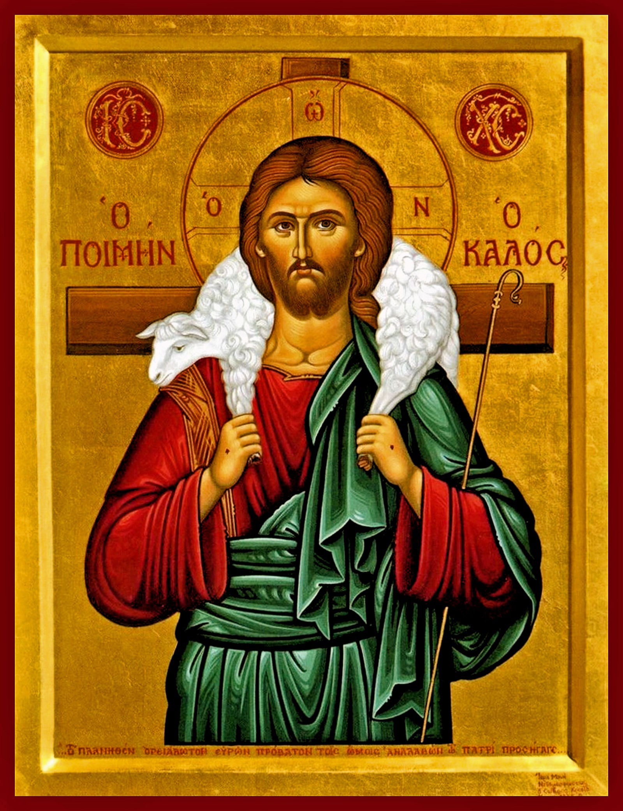

<strong><a class="header" href="#shepherds-call">The Shepherd's Call</a></strong>

<i>An Exposition of the calling and commands of Christ upon his under-shepherds according to John 21:15-19</i>

>John 21:15–19
>15 When they had eaten breakfast, Jesus asked Simon Peter, “Simon, son of John, do you love me more than these?” “Yes, Lord,” he said to him, “you know that I love you.” “Feed my lambs,” he told him.  
>
>16 A second time he asked him, “Simon, son of John, do you love me?” “Yes, Lord,” he said to him, “you know that I love you.” “Shepherd my sheep,” he told him.  
>
>17 He asked him the third time, “Simon, son of John, do you love me?” Peter was grieved that he asked him the third time, “Do you love me?” He said, “Lord, you know everything; you know that I love you.” “Feed my sheep,” Jesus said.  
>
>18 “Truly I tell you, when you were younger, you would tie your belt and walk wherever you wanted. But when you grow old, you will stretch out your hands and someone else will tie you and carry you where you don’t want to go.”  
>
>19 He said this to indicate by what kind of death Peter would glorify God. After saying this, he told him, “Follow me.”  