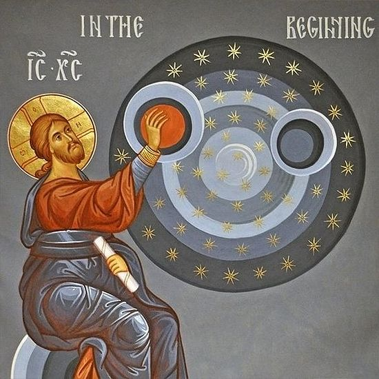

# Genesis 19:1-29 The Gospel Wrath 

## The Text 

>Genesis 19:1–29  
>1 The two angels entered Sodom in the evening as Lot was sitting in Sodom’s gateway. When Lot saw them, he got up to meet them. He bowed with his face to the ground 
>
>2 and said, “My lords, turn aside to your servant’s house, wash your feet, and spend the night. Then you can get up early and go on your way.” “No,” they said. “We would rather spend the night in the square.” 
>
>3 But he urged them so strongly that they followed him and went into his house. He prepared a feast and baked unleavened bread for them, and they ate. 
>
>4 Before they went to bed, the men of the city of Sodom, both young and old, the whole population, surrounded the house. 
>
>5 They called out to Lot and said, “Where are the men who came to you tonight? Send them out to us so we can have sex with them!” 
>
>6 Lot went out to them at the entrance and shut the door behind him. 
>
>7 He said, “Don’t do this evil, my brothers. 
>
>8 Look, I’ve got two daughters who haven’t been intimate with a man. I’ll bring them out to you, and you can do whatever you want to them. However, don’t do anything to these men, because they have come under the protection of my roof.” 
>
>9 “Get out of the way!” they said, adding, “This one came here as an alien, but he’s acting like a judge! Now we’ll do more harm to you than to them.” They put pressure on Lot and came up to break down the door. 
>
>10 But the angels reached out, brought Lot into the house with them, and shut the door. 
>
>11 They struck the men who were at the entrance of the house, both young and old, with blindness so that they were unable to find the entrance. 
>
>12 Then the angels said to Lot, “Do you have anyone else here: a son-in-law, your sons and daughters, or anyone else in the city who belongs to you? Get them out of this place, 
>
>13 for we are about to destroy this place because the outcry against its people is so great before the LORD, that the LORD has sent us to destroy it.” 
>
>14 So Lot went out and spoke to his sons-in-law, who were going to marry his daughters. “Get up,” he said. “Get out of this place, for the LORD is about to destroy the city!” But his sons-in-law thought he was joking. 
>
>15 At daybreak the angels urged Lot on: “Get up! Take your wife and your two daughters who are here, or you will be swept away in the punishment of the city.” 
>
>16 But he hesitated. Because of the LORD’s compassion for him, the men grabbed his hand, his wife’s hand, and the hands of his two daughters. They brought him out and left him outside the city. 
>
>17 As soon as the angels got them outside, one of them said, “Run for your lives! Don’t look back and don’t stop anywhere on the plain! Run to the mountains, or you will be swept away!” 
>
>18 But Lot said to them, “No, my lords—please. 
>
>19 Your servant has indeed found favor with you, and you have shown me great kindness by saving my life. But I can’t run to the mountains; the disaster will overtake me, and I will die. 
>
>20 Look, this town is close enough for me to flee to. It is a small place. Please let me run to it—it’s only a small place, isn’t it?—so that I can survive.” 
>
>21 And he said to him, “All right, I’ll grant your request about this matter too and will not demolish the town you mentioned. 
>
>22 Hurry up! Run to it, for I cannot do anything until you get there.” Therefore the name of the city is Zoar. 
>
>23 The sun had risen over the land when Lot reached Zoar. 
>
>24 Then out of the sky the LORD rained on Sodom and Gomorrah burning sulfur from the LORD. 
>
>25 He demolished these cities, the entire plain, all the inhabitants of the cities, and whatever grew on the ground. 
>
>26 But Lot’s wife looked back and became a pillar of salt. 
>
>27 Early in the morning Abraham went to the place where he had stood before the LORD. 
>
>28 He looked down toward Sodom and Gomorrah and all the land of the plain, and he saw that smoke was going up from the land like the smoke of a furnace. 
>
>29 So it was, when God destroyed the cities of the plain, he remembered Abraham and brought Lot out of the middle of the upheaval when he demolished the cities where Lot had lived.

The world questions whether or not God has the right to judge and execute us. What have we done to deserve this wrath? Your God has no right to touch me! Your God has no right to take my life or the life of my loved one. He must be evil and cruel, not only to allow evil to take place here, but also to judge us.

## This is Our God - He Alone is Creator

### God is Creator over everything 

>John 1:2–3 He was with God in the beginning. All things were created through him, and apart from him not one thing was created that has been created.

>Hebrews 1:2 In these last days, he has spoken to us by his Son. God has appointed him heir of all things and made the universe through him.

>Job 26:13 By his breath the heavens gained their beauty; his hand pierced the fleeing serpent.

>Romans 1:20 For his invisible attributes, that is, his eternal power and divine nature, have been clearly seen since the creation of the world, being understood through what he has made. As a result, people are without excuse.

>Colossians 1:16 For everything was created by him, in heaven and on earth, the visible and the invisible, whether thrones or dominions or rulers or authorities— all things have been created through him and for him.

>Genesis 1:31 God saw all that he had made, and it was very good indeed. Evening came and then morning: the sixth day.

Whether we, as mankind, believe or do not believe that God is Creator matters not -- God is still Creator over all of creation.

Since he is Creator, he has certain inalienable, inviolable rights that belong to being Creator. If you created something, say an invention or a piece of technology, you have certain rights over your creation that can never be taken away from you. What is fascinating is that recent reports of AI say, "Its becoming too dangerous." First, as Dr. Ian Malcolm once famously said, "Our scientists were so preoccupied with whether or not they could, they didn't stop to think if they should." Second, unlike the dinosaurs from Jurassic Park, to stop AI from becoming too dangerous, all anybody has to do is walk up and unplug it. But no one is going to do that because of money. But I digress.
### Second, God rules and reigns over everything 

Nonetheless, God is Creator over all creation, and therefore his rights as Creator are that he alone gets to rule and reign over all creation. That is his right as Creator.

>Romans 9:19-21 You will say to me, therefore, “Why then does he still find fault? For who resists his will?” On the contrary, who are you, a human being, to talk back to God? Will what is formed say to the one who formed it, “Why did you make me like this?" Or has the potter no right over the clay, to make from the same lump one piece of pottery for honor and another for dishonor?

As his creation, we have only the rights given to us by Creator God and nothing more.

We think that, because we have free will, we might fool ourselves into thinking we have absolute freedom. God alone has that absolute freedom.
### Third, God is in the heavens, and he does as he pleases 

>Psalms 115:1-3 Not to us, LORD, not to us,
but to your name give glory
because of your faithful love, because of your truth.
Why should the nations say,
“Where is their God? ”
Our God is in heaven
and does whatever he pleases.

Put it this way -- he is holy, good, perfect, sinless, and righteous, and he is free to do whatever he pleases.

The folly of man -- we want absolute freedom, too. "Give me that, God! I want what you have but I don't you lording over me." Mankind, because we are born of Adam, with sinful hearts running away from God, wants absolute freedom to sin. But there is no freedom in sin -- that only leads to death and the wrath of God. True freedom can be found only in Christ our Lord.

>John 8:34-36 Jesus responded, “Truly I tell you, everyone who commits sin is a slave of sin. A slave does not remain in the household forever, but a son does remain forever. So if the Son sets you free, you really will be free.

### Lastly, God makes demands on his creation -- it is his right as Creator 

This is what we call the covenant of works.

God established this with Adam in the garden, "Do these things and you will live."

Adam failed to meet those demands.
### We have failed to meet his demands 

What did God say would happen if we disobey him? We will surely die. Make no mistake -- Adam & Eve did not drop dead on sight upon taking a mere delicious bite from the forbidden fruit from the forbidden tree. But the fact is they surely did die.

They were meant to live forever. Because of their sin, they perished.
### We shall perish because we are disobedient -- by choice and by birth 

Not too recently, many began debating, for what sin or sins did God destroy Sodom and Gomorrah? Growing up, especially in response to today's culture, from the Sexual Revolution onward, clearly it was the sin of sexual immorality -- specifically, homosexuality, which God calls "detestable", an abomination. (Leviticus 18:22) 

>4 Before they went to bed, the men of the city of Sodom, both young and old, the whole population, surrounded the house. 
>
>5 They called out to Lot and said, “Where are the men who came to you tonight? Send them out to us so we can have sex with them!” 

Obviously, we needed to know the exact reason why God was so heaven-bent on eradicating these two cities off the face of the earth, this would be good reasons.

And this is the charge of our modern culture. You can't say that. You can't say, "God destroyed two cities because of homosexuality." Why? Because we, as mankind, have judged him wrongly, and he cannot do that.

But we just learned in Psalm 115 that he does as he pleases.

But then Jewish teachers would say, "Wait a minute, it wasn't because of sexual immorality -- it was the way they mistreated the poor and the needy."

>Ezekiel 16:49-50 Now this was the iniquity of your sister Sodom: She and her daughters had pride, plenty of food, and comfortable security, but didn’t support the poor and needy. They were haughty and did detestable acts before me, so I removed them when I saw this

God says, "D. All of the above."

They did not help the poor and needy, although they had plenty. They were doing abominable acts before him. So he removed them when he saw this.

Make no mistake -- I am emphasizing "sexual immortality" more so than homosexuality. Why? I don't want the hearer to be lulled into a stupor thinking that his πορνεία heterosexual acts gets ignored by our holy God while πορνεία homosexual acts get the just wrath of the Lord.

It's all πορνεία. It's all sexual immorality. It is all a sin in the eyes of God.
#### Hell is real 

Colossians 3:5-10 Therefore, put to death what belongs to your earthly nature: sexual immorality, impurity, lust, evil desire, and greed, which is idolatry. Because of these, God’s wrath is coming upon the disobedient, and you once walked in these things when you were living in them. But now, put away all the following: anger, wrath, malice, slander, and filthy language from your mouth. Do not lie to one another, since you have put off the old self with its practices and have put on the new self. You are being renewed in knowledge according to the image of your Creator.

#### Torment is real 

#### This is not the torturous work of the devil, nor the mere consequences of our sins but this is the holy wrath of God 

#### That wrath is forever 

## His Gospel 

### But God 

#### alone being rich in neverending mercies 

#### alone who gives grace upon much needed grace 

#### alone whose steadfast love that never stops because it never began 

## Our Response 

### Who is like our God? 

### And who can compare to him? 

### He alone is worthy 
