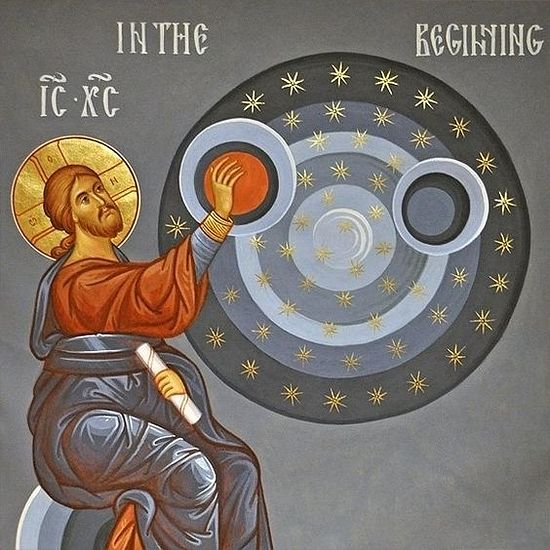

# Genesis 19:30-38 The Gospel Reach

>Genesis 19:30–38  
>30 Lot departed from Zoar and lived in the mountains along with his two daughters, because he was afraid to live in Zoar. Instead, he and his two daughters lived in a cave. 
>
>31 Then the firstborn said to the younger, “Our father is old, and there is no man in the land to sleep with us as is the custom of all the land. 
>
>32 Come, let’s get our father to drink wine so that we can sleep with him and preserve our father’s line.” 
>
>33 So they got their father to drink wine that night, and the firstborn came and slept with her father; he did not know when she lay down or when she got up. 
>
>34 The next day the firstborn said to the younger, “Look, I slept with my father last night. Let’s get him to drink wine again tonight so you can go sleep with him and we can preserve our father’s line.” 
>
>35 That night they again got their father to drink wine, and the younger went and slept with him; he did not know when she lay down or when she got up. 
>
>36 So both of Lot’s daughters became pregnant by their father. 
>
>37 The firstborn gave birth to a son and named him Moab. He is the father of the Moabites of today. 
>
>38 The younger also gave birth to a son, and she named him Ben-ammi. He is the father of the Ammonites of today.

## Pray

## Our God

The law of God is clear on such matters. He has made his commands clear. But this will not be the first time in the bible we will hear of such perversion, nor the last.

No one in their right mind would justify this sort of depravity using the Bible. "Lot and his daughters" or "Jacob and his daughter-in-law" or "the family of David" or even Paul rebuke in his letter to the church in Corinth: "Hey, DO NOT sleep with your stepmom -- just don't"

Just because God records a sin does not mean he allows the sin. Take, for instance, polygamy. God commands marriage to be one man and one woman. Some heroes of the faith, Abraham, David, or Solomon, to name a few, had multiple wives, but that does not justify their actions. Read those passages with spiritual eyes. What I see and read is that we have men of God who were born of Adam and at the same time, born again of God, but still sinned against God. Shocking news is shocking. Each godly man you read about was doing godly things when they had their first wife: Abraham & Sarah, David & Michal, or Solomon & Pharaoh's daughter (*theoretically*, see 1 Kings 3:1).

I want to make this explicitly clear so that no one can misquote me or take me out of context. Make no mistake: Polygamy is sin against God. Sex outside the covenant marriage between one man and one woman is sin against God. Homosexuality is sin against God. Sexual immorality is sin against God. God was crystal clear:

>Exodus 20:14 Do not commit adultery.

So when you read in the Bible about our heroes of the faith (Hebrews 11), and you see where they had more than one living wife at a time, just know that these men were sinning against the Lord their God. Yes, even David, who had multiple wives, was "a man after God's own heart" (1 Samuel 13:14), committed the sin of adultery from the moment he treated someone other than Michal as his own wife.

Often I tell my congregation, "I am not a prophet but..." Then I predict what's going to happen based on my understanding of the Scriptures, philosophy, and our modern world. This is one of those times. I am not a prophet, but mark my words -- the current world, here in America, due to so many people sitting under their own spiritual authority, is going to come to the conclusion that polygamy is allowed by the One Holy God. And it will be your own people- Evangelicals. Don't say you read the Bible and then say something so foolish that it's clear you don't understand or read it. 

### The most depraved 

### The most wicked 

### The most condemnation 

## His Gospel

>John 1:10-13 He was in the world, and the world was created through him, and yet the world did not recognize him. He came to his own, and his own people did not receive him. But to all who did receive him, he gave them the right to be children of God, to those who believe in his name, who were born, not of natural descent, or of the will of the flesh, or of the will of man, but of God.

## Our Response

>2 Peter 2:4-10 For if God didn’t spare the angels who sinned but cast them into hell and delivered them in chains of utter darkness to be kept for judgment; and if he didn’t spare the ancient world, but protected Noah, a preacher of righteousness, and seven others, when he brought the flood on the world of the ungodly; and if he reduced the cities of Sodom and Gomorrah to ashes and condemned them to extinction, making them an example of what is coming to the ungodly; and if he rescued righteous Lot, distressed by the depraved behavior of the immoral (for as that righteous man lived among them day by day, his righteous soul was tormented by the lawless deeds he saw and heard) — then the Lord knows how to rescue the godly from trials and to keep the unrighteous under punishment for the day of judgment, especially those who follow the polluting desires of the flesh and despise authority.

I had mentioned earlier in this chapter that I am no prophet. At that paragraph, I stopped writing (to be continued at a later time, then committed this file on Sunday, October 25, 2026 at 8:09 AM [^1]. On the same day, at the 11 AM service for LifeWorks Church (Wickcliffe, OH), Pastor Israel T. Ford proclaimed before God and his people that he had a second "wife." His first wife stood at the pulpit and introduced her "sister-in-marriage," as they have been living in a polygamous "marriage" for about three years. [^2026-polygamous-marriage]

Just because you see your heroes of the faith doing something God has explicitly commanded us not to do, does not give you nor I permission to do so.

Just because your pastor 

What did Christ tell us? We are in the end days (Matthew 24). But do not fear and do not despair -- Christ is with us always, to end of the days (Matthew 28:20).

[^1]: [Commit 10304a6](https://github.com/joelouthan/Theologicus/commit/10304a6e8f451c300b60cc4c04ff3112fec3b247)

[^2026-polygamous-marriage]: “Pastor’s Wife Surprises Congregation by Introducing ‘Second Wife’ During Service, Describing It as ‘Polygamous Marriage,’” _People.Com_, last modified November 5, 2026, accessed November 18, 2026, [https://people.com/pastors-wife-surprises-congregation-by-introducing-second-wife-during-service-12202546](https://people.com/pastors-wife-surprises-congregation-by-introducing-second-wife-during-service-12202546).

