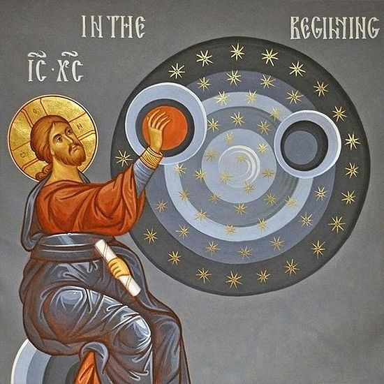

# Genesis 45:1-15 The Gospel Revelation

## The Text

>Genesis 45:1–15  
>1 Joseph could no longer keep his composure in front of all his attendants, so he called out, “Send everyone away from me!” No one was with him when he revealed his identity to his brothers. 
>
>2 But he wept so loudly that the Egyptians heard it, and also Pharaoh’s household heard it. 
>
>3 Joseph said to his brothers, “I am Joseph! Is my father still living?” But they could not answer him because they were terrified in his presence. 
>
>4 Then Joseph said to his brothers, “Please, come near me,” and they came near. “I am Joseph, your brother,” he said, “the one you sold into Egypt. 
>
>5 And now don’t be grieved or angry with yourselves for selling me here, because God sent me ahead of you to preserve life. 
>
>6 For the famine has been in the land these two years, and there will be five more years without plowing or harvesting. 
>
>7 God sent me ahead of you to establish you as a remnant within the land and to keep you alive by a great deliverance. 
>
>8 Therefore it was not you who sent me here, but God. He has made me a father to Pharaoh, lord of his entire household, and ruler over all the land of Egypt. 
>
>9 “Return quickly to my father and say to him, ‘This is what your son Joseph says: “God has made me lord of all Egypt. Come down to me without delay. 
>
>10 You can settle in the land of Goshen and be near me—you, your children, and your grandchildren, your flocks, your herds, and all you have. 
>
>11 There I will sustain you, for there will be five more years of famine. Otherwise, you, your household, and everything you have will become destitute.”’ 
>
>12 Look! Your eyes and the eyes of my brother Benjamin can see that I’m the one speaking to you. 
>
>13 Tell my father about all my glory in Egypt and about all you have seen. And bring my father here quickly.” 
>
>14 Then Joseph threw his arms around his brother Benjamin and wept, and Benjamin wept on his shoulder. 
>
>15 Joseph kissed each of his brothers as he wept, and afterward his brothers talked with him.The Return for Jacob

## Our God

## His Gospel

## Our Response
