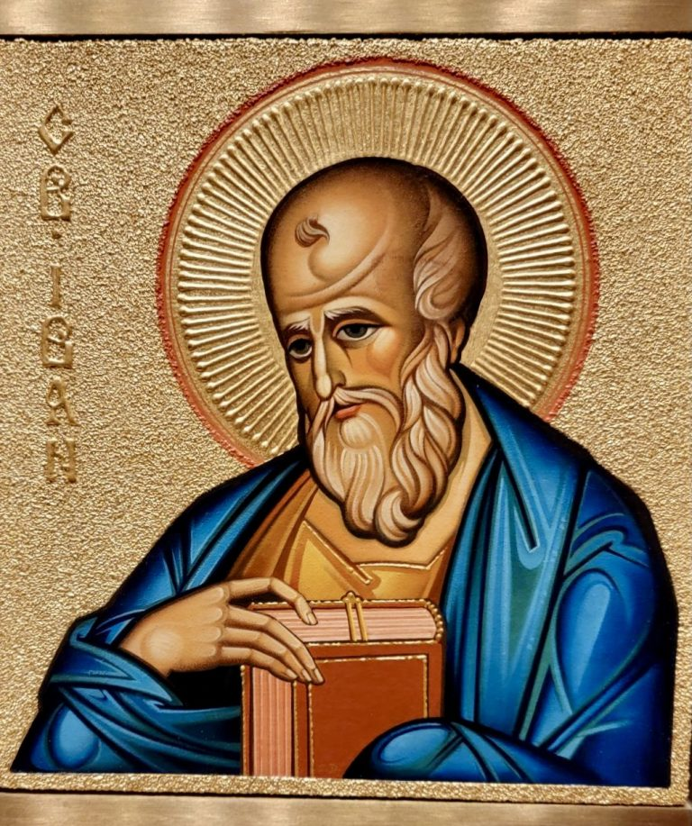

# 📖 John 11:1-44

## The Text

>John 11  
>1 Now a man was sick—Lazarus from Bethany, the village of Mary and her sister Martha. 
>
>2 Mary was the one who anointed the Lord with perfume and wiped his feet with her hair, and it was her brother Lazarus who was sick. 
>
>3 So the sisters sent a message to him: “Lord, the one you love is sick.” 
>
>4 When Jesus heard it, he said, “This sickness will not end in death but is for the glory of God, so that the Son of God may be glorified through it.” 
>
>5 Now Jesus loved Martha, her sister, and Lazarus. 
>
>6 So when he heard that he was sick, he stayed two more days in the place where he was. 
>
>7 Then after that, he said to the disciples, “Let’s go to Judea again.” 
>
>8 “Rabbi,” the disciples told him, “just now the Jews tried to stone you, and you’re going there again?” 
>
>9 “Aren’t there twelve hours in a day?” Jesus answered. “If anyone walks during the day, he doesn’t stumble, because he sees the light of this world. 
>
>10 But if anyone walks during the night, he does stumble, because the light is not in him.” 
>
>11 He said this, and then he told them, “Our friend Lazarus has fallen asleep, but I’m on my way to wake him up.” 
>
>12 Then the disciples said to him, “Lord, if he has fallen asleep, he will get well.” 
>
>13 Jesus, however, was speaking about his death, but they thought he was speaking about natural sleep. 
>
>14 So Jesus then told them plainly, “Lazarus has died. 
>
>15 I’m glad for you that I wasn’t there so that you may believe. But let’s go to him.” 
>
>16 Then Thomas (called “Twin”) said to his fellow disciples, “Let’s go too so that we may die with him.” 
>
>17 When Jesus arrived, he found that Lazarus had already been in the tomb four days. 
>
>18 Bethany was near Jerusalem (less than two miles away). 
>
>19 Many of the Jews had come to Martha and Mary to comfort them about their brother. 
>
>20 As soon as Martha heard that Jesus was coming, she went to meet him, but Mary remained seated in the house. 
>
>21 Then Martha said to Jesus, “Lord, if you had been here, my brother wouldn’t have died. 
>
>22 Yet even now I know that whatever you ask from God, God will give you.” 
>
>23 “Your brother will rise again,” Jesus told her. 
>
>24 Martha said to him, “I know that he will rise again in the resurrection at the last day.” 
>
>25 Jesus said to her, “I am the resurrection and the life. The one who believes in me, even if he dies, will live. 
>
>26 Everyone who lives and believes in me will never die. Do you believe this?” 
>
>27 “Yes, Lord,” she told him, “I believe you are the Messiah, the Son of God, who comes into the world.” 
>
>28 Having said this, she went back and called her sister Mary, saying in private, “The Teacher is here and is calling for you.” 
>
>29 As soon as Mary heard this, she got up quickly and went to him. 
>
>30 Jesus had not yet come into the village but was still in the place where Martha had met him. 
>
>31 The Jews who were with her in the house consoling her saw that Mary got up quickly and went out. They followed her, supposing that she was going to the tomb to cry there. 
>
>32 As soon as Mary came to where Jesus was and saw him, she fell at his feet and told him, “Lord, if you had been here, my brother wouldn’t have died!” 
>
>33 When Jesus saw her crying, and the Jews who had come with her crying, he was deeply moved in his spirit and troubled. 
>
>34 “Where have you put him?” he asked. “Lord,” they told him, “come and see.” 
>
>35 Jesus wept. 
>
>36 So the Jews said, “See how he loved him!” 
>
>37 But some of them said, “Couldn’t he who opened the blind man’s eyes also have kept this man from dying?” 
>
>38 Then Jesus, deeply moved again, came to the tomb. It was a cave, and a stone was lying against it. 
>
>39 “Remove the stone,” Jesus said. Martha, the dead man’s sister, told him, “Lord, there is already a stench because he has been dead four days.” 
>
>40 Jesus said to her, “Didn’t I tell you that if you believed you would see the glory of God?” 
>
>41 So they removed the stone. Then Jesus raised his eyes and said, “Father, I thank you that you heard me. 
>
>42 I know that you always hear me, but because of the crowd standing here I said this, so that they may believe you sent me.” 
>
>43 After he said this, he shouted with a loud voice, “Lazarus, come out!” 
>
>44 The dead man came out bound hand and foot with linen strips and with his face wrapped in a cloth. Jesus said to them, “Unwrap him and let him go.” 

## The Prayer

## Intro

- Sad story and spoiler
- My first experience with my mentor as a false teacher
  - John 11 is about salvation
  - My former mentor: "no its not"
  - God says it is

## The Sermon

- **John 11:1–6** Now a man was sick—Lazarus from Bethany, the village of Mary and her sister Martha.  Mary was the one who anointed the Lord with perfume and wiped his feet with her hair, and it was her brother Lazarus who was sick.  So the sisters sent a message to him: “Lord, the one you love is sick.”  When Jesus heard it, he said, “This sickness will not end in death but is for the glory of God, so that the Son of God may be glorified through it.”  Now Jesus loved Martha, her sister, and Lazarus.  So when he heard that he was sick, he stayed two more days in the place where he was.

### Christ Ordains All Things

- all things means all things
- yes in salvation
- even the mundane?
- **Acts 17:24-28** The God who made the world and everything in it — he is Lord of heaven and earth — does not live in shrines made by hands. Neither is he served by human hands, as though he needed anything, since he himself gives everyone life and breath and all things. **From one man he has made every nationality to live over the whole earth and has determined their appointed times and the boundaries of where they live. He did this so that they might seek God, and perhaps they might reach out and find him, though he is not far from each one of us.** For in him we live and move and have our being, as even some of your own poets have said, ‘For we are also his offspring.’
- that mortgage or that lease you signed?
- that person you married? singleness? divorced?
- kids or no kids
- your job
- your neighbors, friends, enemies, co-workers, family
- all of it has been decreed by God -- ordained by God
- Free will?
  - God never violates it
- Is he the author of sin? Never
- The best example of God decreeing / God ordaining: my ordination
  - This church voted and the elders ordained me
  - Is RTC church or RTC elders the author of everything that I do? **NO**
  - Then is God the author of whatever sin I do? **NO**
- I have been on this earth and been born again long enough
- that every sin I have committed
- every sin against me
- every bit of pain
- every death and loss I have grieved
- was all ordained my God to draw me closer to his Son
- every bit of it
- my dad abusing me as a child
- my mom abandoning me when I was five
- people failed to protect me
- all of it
- was to bring me closer to Him
- "but oh, look at your life now"
- and?
- There are no guarantees of being "blessed" in this life
- If I end up alone and homeless tomorrow
- God is still good
- **Job 1:21** saying: Naked I came from my mother’s womb, and naked I will leave this life. The Lord gives, and the Lord takes away. Blessed be the name of the Lord.
- But God promised us that we will suffered in this life
- because his only begotten Son suffered **Romans 8:17**
- but whatever it takes so that you and I will get home to him
- He will ordain it, he will decree it, he will allow it
- He gave his Son over to live and die for us
- and to put the sins of his people on the back of the Christ
- won't he do it!
- Everything that he has done
- As Spurgeon said, "I have learned to kiss the wave that crashes me upon the Rock of Ages"
- we don't have to look for hard times and suffering
- we are aliens and strangers in the world
- this place is not our home
- hard times and suffering are at hand
- but the Almighty God will sovereignly bring us all the way home
- and that path home is through none other than Christ alone
- ---
- **John 11:7–10** Then after that, he said to the disciples, “Let’s go to Judea again.”  “Rabbi,” the disciples told him, “just now the Jews tried to stone you, and you’re going there again?”  “Aren’t there twelve hours in a day?” **9 Jesus answered. “If anyone walks during the day, he doesn’t stumble, because he sees the light of this world.  But if anyone walks during the night, he does stumble, because the light is not in him.”**

### Christ is the path to life - Christ is Life

- **Psalm 16:11** You reveal the path of life to me; in your presence is abundant joy; at your right hand are eternal pleasures.
- God has revealed that path
- That path is Jesus Christ
- Controversial but true
> All paths lead to God
> Yet only one path is protected by
> the love and covenant blood
> of the Almighty Lord Jesus Christ
> all other paths lead right into
> the wrath of the Almighty Lord  Jesus Christ.
>  - Sproul
- What is the path? The path of life that only leads to abundant joy, pleasures evermore, and actual perfect satisfaction that is only in Christ Jesus **Psalm 17:15**
- **1 John 1:6-8** **If we say, “We have fellowship with him,” and yet we walk in darkness, we are lying and are not practicing the truth. If we walk in the light as he himself is in the light, we have fellowship with one another, and the blood of Jesus his Son cleanses us from all sin.** If we say, “We have no sin,” we are deceiving ourselves, and the truth is not in us.
- **Free offer of the gospel** - Christ has shone the light on the path
- ---
- **John 11:11–16** He said this, and then he told them, “Our friend Lazarus has fallen asleep, but I’m on my way to wake him up.”  Then the disciples said to him, “Lord, if he has fallen asleep, he will get well.”  Jesus, however, was speaking about his death, but they thought he was speaking about natural sleep.  So Jesus then told them plainly, 15 **“Lazarus has died.  I’m glad for you that I wasn’t there so that you may believe. But let’s go to him.”**  **Then Thomas (called “Twin”) said to his fellow disciples, “Let’s go too so that we may die with him.”**

### The Disciple Got "It" But Not All The Way

- Thomas making the bold declaration
- Same disciple who said, "I won't believe unless I touch his wounds"
- This is like the blind man who saw trees: **Mark 8:22-26**  **He looked up and said, “I see people — they look like trees walking.”**
  - When Jesus touched his eyes again, the blind man can now see
- We don't see everything
- Why we go through the things we go through
- Why we suffer the ways we suffer
- Why it feels like we are repenting of the same sins over again
- But God knows
- and God reveals
- and it God that gives the growth
- it is God who matures us
- it is the unbreakable promise of God that he is conforming us to look like his Son
- We are righteous and we will be righteous like his Son
- all at the same time
- ---
- **John 11:17–27** When Jesus arrived, he found that Lazarus had already been in the tomb four days.  Bethany was near Jerusalem (less than two miles away).  Many of the Jews had come to Martha and Mary to comfort them about their brother.  As soon as Martha heard that Jesus was coming, she went to meet him, but Mary remained seated in the house.  **21 Then Martha said to Jesus, “Lord, if you had been here, my brother wouldn’t have died.  Yet even now I know that whatever you ask from God, God will give you.”  “Your brother will rise again,” Jesus told her.  Martha said to him, “I know that he will rise again in the resurrection at the last day.”  Jesus said to her, “I am the resurrection and the life. The one who believes in me, even if he dies, will live.  Everyone who lives and believes in me will never die. Do you believe this?”  “Yes, Lord,” she told him, “I believe you are the Messiah, the Son of God, who comes into the world.”**
- **THE ONLY TAKEAWAY**: **I AM THE RESURRECTION AND THE LIFE. THE ONE WHO BELIEVES IN ME, EVEN IF HE DIES, WILL LIVE. AND EVERYONE WHO LIVES AND BELIEVES IN ME WILL NEVER DIE. DO YOU BELIEVE THIS? (JOHN 11:25-26)**

### Christ is the Resurrection

- **John 11:25** Jesus said to her, “*I am the resurrection* and the life. *The one who believes in me, even if he dies, will live.*
- If you want to live, turn to the Christ
- If you do not want to die, turn to the Christ
- If you do not want to perish in your sins, turn to the Christ!
- **John 3:14–15** “Just as Moses lifted up the snake in the wilderness, so **the Son of Man must be lifted up**,  so that everyone who believes in him may have eternal life.
  - Christ is lifted upon the cross so that his people are saved from their sins -- once for all!
  - Christ is lifted up from death to life so that his people will know that they will never perish but have everlasting life!
  - Christ is lifted up and has ascended to the right of the Father -- and to him was given dominion and glory and the kingdom of God -- it is an everlasting dominion and his kingdom will never be destroyed **Daniel 7:14**

### Christ is the Life

- **John 11:25** Jesus said to her, “*I am* the resurrection and *the life. The one who believes in me, even if he dies, will live.*"
- You and I are in the forever kingdom of God
- God will never perish
- God's children will never perish
- God has ransomed his only begotten Son's life for the lives of his children
- Our Father is a perfect Father -- he is the only Father who will never lose any of his children -- never!

### Christ is the Great I Am - Christ is God

- **John 11:25** Jesus said to her, “*I am* the resurrection and the life. *The one who believes in me, even if he dies, will live.*"
- Seven distinct I Am declarations of Christ
- Not in the Bible randomly
- Jehovah Witnesses and most of the world who try to read the Bible without the Spirit opening their eyes to see will ignorantly state, "Well, Jesus never said he was God."
- Then why were the Jews so quick to stone him to death for blasphemy?
- **Exodus 3:14** God replied to Moses, “I AM WHO I AM. This is what you are to say to the Israelites: I AM has sent me to you.”
- Seven times Jesus preached and declared, "I AM the God of Abraham, Isaac, and Jacob. I AM the God who rescued your people out of slavery in Egypt"
- **Gospel** With every I AM, Jesus is preaching his gospel:
  - I AM the only God who will rescue you from slavery to sin.
  - I AM the only God who will save you from perishing
  - I AM the only God who will give you abundant life everlasting
- Paul asked "Who is going to rescue me from this body of death?"
- Jesus answers, "I AM the one who will rescue you from this body of death" **Romans 7:24-25**

## The Closing - The Passion of our Lord

- **John 11:31–37** The Jews who were with her in the house consoling her saw that Mary got up quickly and went out. They followed her, supposing that she was going to the tomb to cry there.  As soon as Mary came to where Jesus was and saw him, she fell at his feet and told him, “Lord, if you had been here, my brother wouldn’t have died!”  When Jesus saw her **crying**, and the Jews who had come with her **crying**, he was **deeply moved in his spirit and troubled**.  “Where have you put him?” he asked. “Lord,” they told him, “come and see.”  **Jesus wept**.  So the Jews said, “See how he loved him!”  But some of them said, “Couldn’t he who opened the blind man’s eyes also have kept this man from dying?”
- **John 11:35** Jesus wept.
- Jesus is fully God and *fully man*

### Consider the inspiration of the Holy Spirit

- *If the Holy Spirit had not put in there "Jesus wept", heresies about the Christ will be beyond rampant what they have been so historically*
- The current heresy that we are dealing with: Christ is not fully God  "Christ laid down some of his glory and his divine to become man" 🛑
- Imagine if "Jesus wept" wasn't in there
  - Then you would have Christians speaking like a Muslim "Well, Christ is not fully man" 🛑
- Jesus **loved** Lazarus
  - He wept, grieved, cried over the loss of his friend

### Consider the hotness of your tears down your cheeks

- Death had match point "came to the tomb"
- With the tears still hot from his weeping
- *not explicit* but those who've cried hard, just tears? was there snot
- His beard soaking up all the sorrow he held in his heart for his friend
- **John 11:38** Then Jesus, deeply moved again [. . .]
- Face hot with tears
- Beard soaked with sorrow
- Christ *deeply moved* with anguish and grief in his soul
- Christ looks towards the tomb and **stares down Death**
- *Stares* - as though he was far off
- Look at the text
- **Christ came to the tomb**
- Christ didn't just stare down
- **comes face to face with death**

### The Gospel

- **John 11:39** “Remove the stone,” Jesus said.
  Martha, the dead man’s sister, told him, “Lord, there is already a stench because he has been dead four days.”
- The path of Christ removes ALL OBSTACLES to God
  - Your sin
  - Your death
  - Your life
  - Your struggle
  - All evilness against you
  - Your tears
  - Wiped cleaned
  - Run to God, RUN!
- **John 11:40** Jesus said to her, “Didn’t I tell you that if you believed you would see the glory of God? ”
  - **2 Corinthians 2:15-16** For to God we are the fragrance of Christ among those who are being saved and among those who are perishing. To some we are an aroma of death leading to death, but to others, an aroma of life leading to life. Who is adequate for these things?
  - To Martha and all the witnesses: stench of death
  - In Christ, we die in him in order to be born again
    - Christ is the fragrance of life
- **John 11:41-42** [. . .] “Father, I thank you that you heard me. I know that you always hear me, but because of the crowd standing here I said this, so that they may believe you sent me.”

### How Did God Save Us?

- The Sovereign Almighty God loves us before time and space
- in other words, he predestined us, he chose us, justified/sanctified/glorified us -- leave no doubt
- But one aspect of salvation we should always meditate upon
- The calling of God
- God has called you by name
- That God calls us from death to life
- When he saves us, he calls us out of this body of death into life everlasting
- And I know we might hear that and immediately think of ourselves, "what has God has called me to be?"
  - **1 John 5:1** Everyone who believes that Jesus is the Christ has been born of God, and everyone who loves the Father also loves the one born of him.
- Dear Christian, do you know what you know what you have been called to do?
- You have called to live!
- **Ezekiel 37:3-4** Then he said to me, “Son of man, can these bones live? ”
  I replied, “Lord GOD, only you know.”
  He said to me, “Prophesy concerning these bones and say to them: Dry bones, hear the word of the LORD!
- Dead man who is dead in your trespasses and sins, hear the word of the Lord! **Ephesians 2:1**
- **John 11:43** After he said this, he shouted with a loud voice, “Lazarus, come out! ”

### Go and live

- **John 11:44** The dead man came out bound hand and foot with linen strips and with his face wrapped in a cloth. Jesus said to them, “Unwrap him and let him go.”'
- The first person Lazarus, after being resurrected from the dead was Jesus ("Jesus came to the tomb")
- Beloved, you were once dead
- Look at the Christ.
- You wanna know what you have been called to do?
  - You have been called by God to go and live for him
- You wanna know what you have been called to do?
  - Go and sin no more!
  - How?
  - Because God does not condemn you because you have his only begotten Son who perfectly obeyed, lived, died, and rose again for you **John 8:1-11**
- You wanna know what you have been called to do?
  - Look the Christ
  - See what the Lord has done for us
  - like the old song goes
  - Give thanks because he has given Jesus Christ his Son

## The Prayer

## ⚔️

## Bibliography
