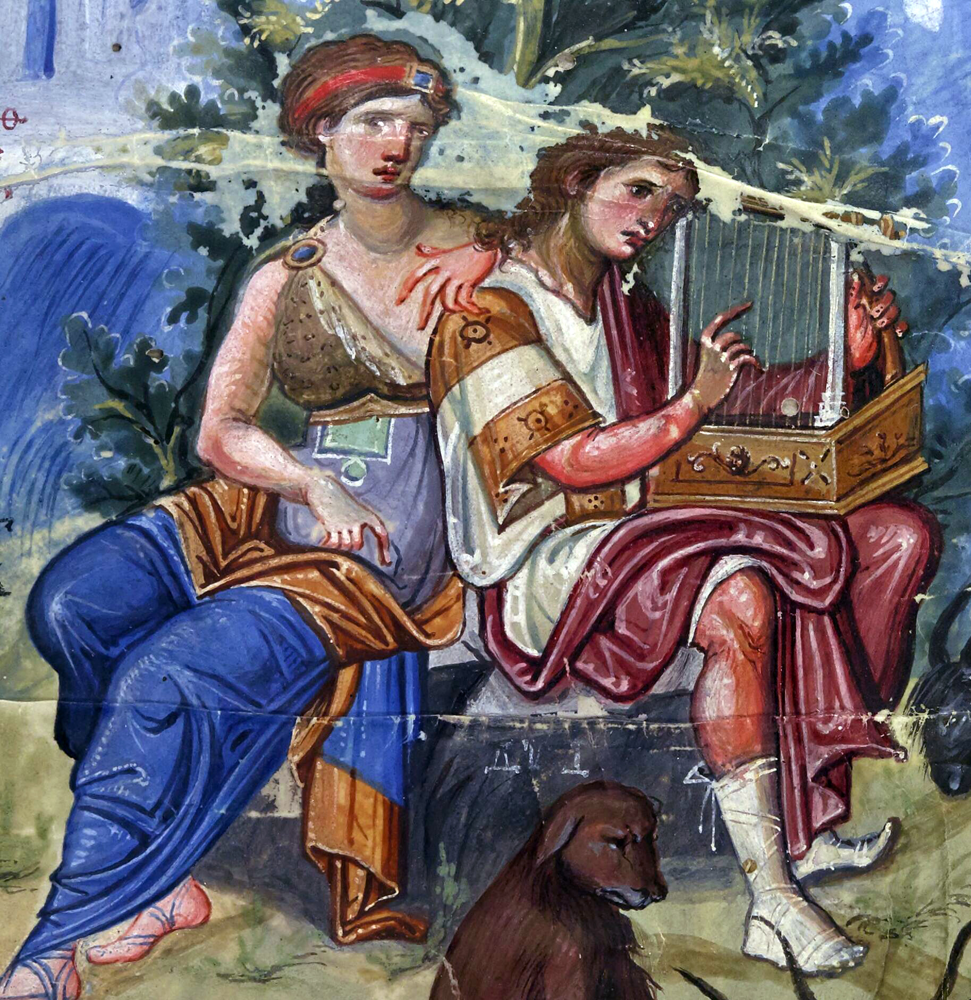

# Psalm 73 Yet God is Good

<i>A Personal Confession of Faith</i>

## The Text

>Psalm 73 
> A psalm of Asaph. 
>
>1 God is indeed good to Israel, to the pure in heart. 
>
>2 But as for me, my feet almost slipped; my steps nearly went astray. 
>
>3 For I envied the arrogant; I saw the prosperity of the wicked. 
>
>4 They have an easy time until they die, and their bodies are well fed. 
>
>5 They are not in trouble like others; they are not afflicted like most people. 
>
>6 Therefore, pride is their necklace, and violence covers them like a garment. 
>
>7 Their eyes bulge out from fatness; the imaginations of their hearts run wild. 
>
>8 They mock, and they speak maliciously; they arrogantly threaten oppression. 
>
>9 They set their mouths against heaven, and their tongues strut across the earth. 
>
>10 Therefore his people turn to them and drink in their overflowing words. 
>
>11 The wicked say, “How can God know? Does the Most High know everything?” 
>
>12 Look at them—the wicked! They are always at ease, and they increase their wealth. 
>
>13 Did I purify my heart and wash my hands in innocence for nothing? 
>
>14 For I am afflicted all day long and punished every morning. 
>
>15 If I had decided to say these things aloud, I would have betrayed your people. 
>
>16 When I tried to understand all this, it seemed hopeless 
>
>17 until I entered God’s sanctuary. Then I understood their destiny. 
>
>18 Indeed, you put them in slippery places; you make them fall into ruin. 
>
>19 How suddenly they become a desolation! They come to an end, swept away by terrors. 
>
>20 Like one waking from a dream, Lord, when arising, you will despise their image. 
>
>21 When I became embittered and my innermost being was wounded, 
>
>22 I was stupid and didn’t understand; I was an unthinking animal toward you. 
>
>23 Yet I am always with you; you hold my right hand. 
>
>24 You guide me with your counsel, and afterward you will take me up in glory. 
>
>25 Who do I have in heaven but you? And I desire nothing on earth but you. 
>
>26 My flesh and my heart may fail, but God is the strength of my heart, my portion forever. 
>
>27 Those far from you will certainly perish; you destroy all who are unfaithful to you. 
>
>28 But as for me, God’s presence is my good. I have made the Lord GOD my refuge, so I can tell about all you do.

## Pray

## The Intro Yet God is good

### First rodeo

### Feedback from David

### Don't miss the point of the sermon!

### Yet God is good

- **1** God is indeed good to Israel, to the pure in heart.
- Evil abounds and seems only to prosper, yet God is good.
- I am tempted at all times to become a fool like them, yet God is good.
- I was jealous of their prosperity, and lo, I am the stupid beast like them, yet God is good
- He has given me the path of life
- He will lead me to glory
- Because God is so good, he's so good to me

## This is God. Despite the world around us and despite ourselves, God is indeed good to his people whom he loved with an everlasting love

### The world might be like this but God is still good to us

### Wed night crew Conspiracies

- Common thread: the prosperity of evil
- You see it, I see it, and Asaph saw it
- He saw things all around
- Don't you know it wasn't just the enemies of God, like the Philistines over there?
- Don't you know he had to see it in King David's court and in his own nation?
- Asaph opened his eyes and saw wickedness

### vv4-10 is total depravity

### Easy to judge

- All unrighteousness, evil, greed, and wickedness
- Evil abounds
- Evil abounds and evil prospers
- All of these things are true
- But did you catch this one thing in verse 3? What did Asaph see?
- **Psalms 73:3** For I envied the arrogant; I saw the <mark>prosperity of the wicked</mark>.
- Be honest
- We wish we lived in a world
- that if you do bad things, bad things happen to you
- And if you live good, good things happen to you
- The world calls that karma
- Put a Christian spin on it, and what do we get?
- Prosperity gospel garbage

### Truth be told: we do want evil to be punished -- that is a given

- Yet, we make mistakes when we sin, when we do what is evil,
- do we want full consequences or less than?
- And not even when we have done good
- When we are decent -- when we have done the bare-minimum good
- we want all the honor and riches and accolades, thank-yous, and attaboys

#### But the fact of the matter is

- Evil does prosper in this world

### Have you ever asked yourself, 'why does evil prosper?'

- It seems that they have accomplished their ill-gotten gains
- But along the way, why does it seem they acquire so much power, fame, and money
- In order to carry out their deeds

#### **12** Look at them—the wicked! They are always at ease, and they increase their wealth.

- The powerful, famous, and wealthy heathens
- They have made a series of sin-filled choices
- that have oppressed others
- and raised them up
- What they don't know is that
- All power comes from God
- All fame comes from God
- All money comes from God
  - **Matthew 5:43-45** “You have heard that it was said, Love your neighbor and hate your enemy. But I tell you, love your enemies and pray for those who persecute you, so that you may be children of your Father in heaven. <mark>For he causes his sun to rise on the evil and the good, and sends rain on the righteous and the unrighteous.</mark>
  - **Job 25:3** ... Does his light not shine on everyone?
  - **Luke 6:35** For he is gracious to the ungrateful and evil.
  - **Acts 14:16-18** In past generations he allowed all the nations to go their own way, although he did not leave himself without a witness, since he did what is good by giving you rain from heaven and fruitful seasons and filling you with food and your hearts with joy.” Even though they said these things, they barely stopped the crowds from sacrificing to them.
- If our paychecks come from God
- Why is it any different for unbelievers?
- Are they not image-bearers of God as well?
- When it comes to God's mercies and common grace for all mankind, there is no difference in who gets what from God
- <mark>The air we breath, our health, and lives come from God</mark>

#### The only difference between believers and unbelievers

- His only begotten Son, our Lord Jesus Christ
- Listen
- With no repentance
- No turning away
- No gratefulness
- Without the salvation of Christ, they would fall into eternal damnation, the wrath of Christ
- Without God, unbelievers live for this world
- Because of this, here on earth, this is the best it's ever gonna be for them

#### For the unbeliever, earth is their heaven

- And those who do not believe in God
- They are desperate
- They gotta get all they can
- All the power, fame, and wealth
- and they got to hold on to it for literally dear life

#### Let me remind you, little children

- Because we have the Christ,
- everything on this earth is the worst its ever going to get for us
- for so many of us -who have been through the worst pain and trauma
- This is our hell on earth
- We cannot imagine what heaven and being in the physical presence of God is going to be like
  - **Romans 8:18** For I consider that the sufferings of this present time are not worth comparing with the glory that is going to be revealed to us.
- Do not think heaven is just slightly better than earth
  - *Ahh, this is a tad bit more comfortable*
- In heaven, with God, it is not like:
  - Like we moved up from a motel to a 5-star penthouse suite.
  - Eating dinners from a vending machine to room service: the steak, the lobster, and a decently priced bottle of wine
  - From bedbugs to turn-down service with mints on the pillow
- NO!
- To think of heaven like that is comparing apples to apples
- To be in heaven means that we are in the sight- presence of the Almighty God
- We will be perfectly perfect in the actual, real perfection of our great God and Savior
- We will spend eternity with God
- Earth has no comparison
- No more cancer
- No more disease
- No more unresolved conflict
- No more trauma
- No more misunderstandings
- No more guilt
- No more grief
- No more hurt
- No more pain
- No more misunderstandings
- No more conflicts--all conflicts will actually be resolved
- No more sin
- Every tear -from sadness, loss, frustration, confusion, anger -wiped clean from our faces by the hands of our Lord Jesus Christ, once and for
- In heaven, with God
- And to quote **Psalm 16:11**
  - Since God has not sent us to hell and he has not allowed us to see decay of our bodies and souls
  - Our hearts will be finally glad
  - Our whole being finally rejoices
  - Our whole body will finally be at perfect rest
  - Because he has given us the Christ
  - we get to be with him
  - with endless joy
  - and boundless, endless pleasures forevermore

## Despite ourselves, God is good to us

- ****Psalm 73:2–3** But as for me, my feet almost slipped; my steps nearly went astray. For I envied the arrogant; I saw the prosperity of the wicked.**
- Did Asaph want what evil has?
  - "He didn't envy their sin"
  - But he did covet what they had in their possession: fame, power & wealth
- *Verses 4-12*
- They have the easy life
- They are seemingly not afflicted
- They are full of pride
- They are allowed to be destructive with zero care whether people get hurt or not
- They speak blasphemies against God
- They speak trash against
- And yet they still BREATH God's air

### Going back to our wishing for our version of "karma" trash prosperity gospel

- Imagine if God worked like that
  - Like a capricious, wicked God that does things without rhyme or reason
- Then, when we did something that this "God" didn't like
- We would be struck dead
- That might be okay for our enemies
- But what about us?
- Who were born sinners and sinned against God
- We were once enemies of God, the Bible says
  - *Boom! Drop to the floor*
- And if God operated like that, we would perish
- We know God is not like that
- Because he gave his Son, Jesus Christ
- and we have His Word- His Holy Scriptures
- The fact that we can read Psalm 73, and I am preaching Psalm 73, and you are hearing me preach Psalm 73
- is proof that God doesn't instantly drop us because of our sin
- Take a look a closer look
  - **3** For I envied the arrogant; I saw the prosperity of the wicked.
- There are two sins in this passage
- The wicked and Asaph's envy

### Comparison is the thief of joy envy & jealousy are evil, come from within, and defile a person

- If God were not so good and merciful to his people, we would instantly die from the moment we sinned,
  - we would not have had Psalm 73
  - -because Asaph wouldn't have lived long enough to write it

> **Caution**
> What's a little jealousy?
> Being envious doesn't hurt anyone, right?
> It's a harmless sin, right?

#### Hear the word of the Lord on the sin of envy and jealousy within a person

- **Proverbs 14:30** A tranquil heart is life to the body, but jealousy is rottenness to the bones.
- **James 3:16** For where there is envy and selfish ambition, there is disorder and every evil practice.
- **Ecclesiastes 4:4** I saw that all labor and all skillful work is due to one person’s jealousy of another. This too is futile and a pursuit of the wind.
- **Galatians 5:26** Let us not become conceited, provoking one another, envying one another.
- **Proverbs 23:17–18** Don’t let your heart envy sinners; instead, always fear the Lord.  For then you will have a future, and your hope will not be dashed.
- **Mark 7:20–23** And he said, “What comes out of a person is what defiles him.  For from within, out of people’s hearts, come evil thoughts, sexual immoralities, thefts, murders,  adulteries, greed, evil actions, deceit, self-indulgence, envy, slander, pride, and foolishness.  All these evil things come from within and defile a person.”

### Because of the word of God, I am fully convinced that Asaph saw the wickedness around him and was in deep despair. Yet by God's tenderest mercies, he saw his own wickedness and repented

- **Psalms 73:3** For I envied the arrogant;
  I saw the prosperity of the wicked.
- **Psalms 73:2** But as for me, my feet almost slipped;
  my steps nearly went astray.
- **Psalms 73:15** If I had decided to say these things aloud, I would have betrayed your people.

### Here is your apt: God is so good to us

- He is merciful and kind
- His steadfast love never comes to an end
- God has saved us
- And he alone grant us repentance
- to turn our eyes back onto his Son, Jesus Christ

### God does not instantly drop the wicked and the sinner

### Yet God does strike us, his people, whom he loved before the foundation of the world, right to our hearts--rips our stone-cold hearts out and gives us new hearts with his Spirit

### Asaph had the gospel

- inasmuch as the OT has revealed it to him
- he knew it truly but not fully
- In his repentance, Asaph had the grace of God
- He was still waiting for the Messiah

#### Church, we have the gospel of Christ

- Because we have the fullness of Christ who is our Messiah
- Because of that
- We have more than the grace of God in our sin and in our repentance
- We have grace upon grace

## This is the gospel of Christ: God has not struck you dead in your sins; God has struck you and pierced you in the heart **Acts 2:36**

### People of God, God has given you his only begotten Son!

- You believe in his Son
- The Triune God dwells in you
- Therefore God has commanded you and me to be content in having everything in his only begotten Son, Jesus Christ.

### Do not fall for the shiny new thing--something not the gospel and someone not God

- Paul preaches the gospel on Mars Hill in Acts 17
- The audience moans and groans
  - "tell us something we don't know"

### Saints as sinners began with the wandering eye looking for something new because they are comparing what others have and what we don't have

- "There has got to be something new other than the power of God in salvation for those who believe -there has to be some new thing"
- There is nothing new
- There is no new presence, no new promise, no new power, nothing new under the Son
- One, Jesus Christ is the same yesterday, today, and forever
- Two, thank God He is unchanging because you and I keep doing the old, wicked, and sinful things

### You and I sin every day of every week

### You and I are never perfect in thought, word, and deed

- Even the most type A hardcore people
- Can appear on the outside
- Do right things
- Say the right things
- But what absolutely levels the playing field
- Are the thoughts inside our heads and hearts
- No way we would show those to another human
- Yet God knows our thoughts perfectly

#### EVERY SINFUL THOUGHT - EVEN WHEN WE ARE JEALOUS, ENVY and COVET WHAT OTHERS HAVE

- He has already taken an account of our sins
- and instead of striking us dead where we stand
- and sending us all to hell

#### What did he do?

- He sent his only begotten Son
- He speaks perfectly, he does perfectly, and he thinks and feels perfectly
- And he did it to glorify his Father
- and to save you from your sins
- The Father gave us his Son
- So that Christ could take away your sinful inner being
- And give you His perfect righteousness

#### He could have struck us dead

- Instead, God was merciful and kind and abounding in steadfast love
- and struck us and pierced to our hearts
- took out our old, sin-filled hearts
- gave us his heart
- gave us new desires for him
- and made his home in us
- And one day
- by the power of the Spirit within us
- We will come all the way home to heaven
- to finally be with God forever and ever

### When was Asaph's mind and heart changed?

- How did he turn his sight from what the wicked were doing,
- being jealous of that
- to not being jealous -not being envious -not wanting the prosperity of the wicked?
- What changed his mind?
- What caused him to repent?
- The correct answer is God
  - But how?
  - **Psalms 73:16-17** When I tried to understand all this, it seemed hopeless until I entered God’s sanctuary. Then I understood their destiny.

#### When I try to wrap my brain around it, I go headlong into despair and hopelessness because it does not make sense

#### Yet, when I step into the sanctuary of God, then it all makes sense--in other words...

- In his mercy, when God grants me repentance
- I repent and turn to God
- When I set my mind on the things of God
- and turn my eyes and my heart towards the Lord
- And see and dwell on what God has done for me

#### Dear church, how do we turn our eyes towards God--what is going to snap us out of this funk of hopelessness and despair?

- When I hear the gospel of God
  - **Romans 10:17** So faith comes from what is heard, and what is heard comes through the message about Christ.
- When do I hear the gospel of God
  - in this church, every Lord's day
- When I hear of what God has done for me
- That God has given me the Christ
- and God has given eternal life with him forevermore
- Now I don't have to focus on the wicked
- I don't have to compare myself to no one else
- not in real life
- and certainly not to the fake lives on social media
- But focus on the source of all good, which is Christ our Lord

### And Asaph knew, you know, and I know and believe this gospel

- So when you see the unbelievers -the wicked, the unsaved, the lost?
- Pray for them
- God says, pray for them
- Pray that Christ saves them --
- Because there is no other name by which we are saved
- Why pray for them?
- **Psalms 73:27** Those far from you will certainly perish; you destroy all who are unfaithful to you.

#### Without Christ

- They will fall into ruin--
- Instead of being rescued into the mercies of Christ
- they will fall into the wrath of the Almighty Christ

## Since we have the Christ, this is the command of God to us: be content in the love of God that can only be found in Christ Jesus our Lord

- Why does God commands us to be content in his Son?
- Look at the inner turmoil of Asaph
- **13** Did I purify my heart and wash my hands in innocence for nothing?
- **14** For I am afflicted all day long and punished every morning.
- **Psalms 73:21-22** When I became embittered
  - and my innermost being was wounded,
  - I was stupid and didn’t understand;
  - I was an unthinking animal (*ignorant beast*) toward you.
  - In other words, because of my sin, I am no wiser nor smarter than livestock

### What did Jesus call his people? His sheep, his little lambs (John 6, 21)

- Romans 8 in the ESV: "We are being afflicted all day long"
  - Paul quotes Zechariah that we are "sheep to be slaughtered"
- Do you know anything about sheep?
- I have a beloved pastor who went to college and seminary on that big farmer 4H money
- He loves to share in his sermons, "You can get sheep to run into the side of the barn"
- Christ is the good shepherd, and we are his sheep
- We are his sheep because we are so easily led astray
- We ain't that smart nor wise
-
- If we were so smart and so wise, why do we keep being "led astray by various passions and pleasures", "disobedient", and "deceived"? **Titus 3:3**
- Why do we keep getting distracted by new and shiny things
- Why do we keep falling for sins of jealousy and envy?
- We will fight our wandering hearts that is trying to find something other than the Christ that is found in his gospel
- Something as old and ordinary as the gospel can't be all there is
  - Give me something more
  - I know, Instagram
  - I know, Facebook
  - I know, Twitter
  - I know, Pinterest
  - I know, Fox News
- Proves the point: all the intelligence and all the wisdom and knowledge in the world does not save us
- We have gotten more information and we have fallen more into depravity
- Whatever can save us is not out there in the world--it definitely is not on the Internet

### What or who can save us? Christ is all-smart, all-wise, and all-good--has saved us because he is indeed good to us because he loves us

#### Remember, God alone is good

- **Psalms 73:1** God is indeed good to Israel,
  to the pure in heart.

#### God has appeared to save us

- **Titus 3:4-7** But when the kindness of God our Savior and his love for mankind appeared, he saved us —not by works of righteousness that we had done, but according to his mercy — through the washing of regeneration and renewal by the Holy Spirit. He poured out his Spirit on us abundantly through Jesus Christ our Savior so that, having been justified by his grace, we may become heirs with the hope of eternal life

#### God has us forever, no matter what

- **Psalms 73:23-26** Yet I am always with you;
    you hold my right hand.
    You guide me with your counsel,
    and afterward you will take me up in glory.
    Who do I have in heaven but you?
    And I desire nothing on earth but you.
    My flesh and my heart may fail,
    but God is the strength of my heart,
    my portion forever.

### What do we preach every Sunday?

- We have failed every week
- We have sinned every week
- So we come to church every week
- We need to remember every week
- that God has saved us every week

#### We have no one in heaven but the Lord

- And since we have these new hearts by God, with new desires by God
- Who or what else on earth can we desire but God?
- All rhetorial questions
- No one else
- Nothing else
- We are called to be content in Christ because all we have is Christ
- Everything that is good in this world comes from Christ, the all-high
- Be content in Christ
- Hebrews & Romans says: "As children of God, we are co-heirs with Christ who has inherited everything"
- We have the Christ. We have everything.
- Puritan prayer: "In Christ, you have given us so much that heaven and earth could give me no more."

#### Listen, you and I are going to fail

- We are going to sin in every thought, word, and deed
- **Christian never forget**
- That despite our wickedness and our sin
- God is so good to us
- And he saved us
- And he has conformed us
- and he will conform us
- to look like his only begotten Son

#### NEVER EVER FORGET - DESPITE ALL OF YOUR FAILURES AND SINS AND WICKEDNESS

- **You are a new creature in Christ**
- **God is the strength of your heart**
- **God is your portion and strength**
- **You have everything you need because you have Christ**
- **Forevermore**

## Need something to do--rest in Christ alone

- Let me make a deal with you
- When we start resting in Christ alone and doing it well
- When we get to a place where we don't need the gospel
- Then the elders will preach something else
  - simple as that
- You wouldn't take that deal, why?
- because we know we don't rest in Christ well at all
- Not on this side of heaven
- Hear the word of the Lord for us:
  - **Psalms 73:28** But as for me, God’s presence is my good. I have made the Lord GOD my refuge, so I can tell about all you do.
- The last verse of the psalm
  - God is my good
  - God is my refuge
  - We must preach the good news of what God has done for us

### RTC: rest in the perfection of Christ alone

- Because you are continuously in his presence
- Because you belong to him
- and God belongs to you
- God is now your refuge
- What do you do when you are in refuge?
- You rest!

### RTC, we are never going to stop telling you, "rest in Christ"

- That is the gospel of Christ
- If you think are going to change our minds about preaching this gospel, think again
- If we do change our minds, you should run for the hills.
- Because I know we are terrible at resting in Christ
- Because I know we sin all the time
- So never forget Christ is our rest
- Never forget that Christ is our good, our presence; he is the strength of our heart and our portion forevermore.

## Pray My God, be our rest, our comfort, our refuge, our strength, and our portion. Because you are God, and we have been saved by your Son, you have commanded that we insist on the gospel so that we will believe God and devote ourselves to the good works you have prepared for us to do. I pray that we would tell each other and remind each other of the gospel of Christ--what you have done for us in him--our only, only loveliest Savior, Jesus Christ. (Psalm 73:28; Titus 3:8)

## ⚔️

- We are now going to partake of the Lord’s Supper together.
- This Table is medicine for the sick, sustenance for the weak, and a reminder for the forgetful.
- We come to this Table as sinners to the Savior of sinners.
- We come worthily to the Table when we come as the unworthy to the Savior who invites us and makes us worthy in Himself.
- If you’re coming in agreement with God concerning your sin, and Christ is your only hope for righteousness, forgiveness, and eternal life.
- And if you’re a baptized member of a church that preaches the gospel of God’s free grace in Christ.
- And you aren’t under the discipline of this or any such body—We invite you in the Name of Jesus Christ to come to this Table.
- To come & receive all Christ holds out to you by faith.
- Come with joy, in gospel faith, bringing all your needs and weaknesses to Christ, and receive His perfect sufficiency set before you at this Table.
- However, if you don’t meet that description, we warn you in the Name of Jesus Christ not to come.
- But know this!—you’re absolutely free to partake of the Lord where you’re seated. His invitation’s freely offered to every sinner & it’s unchanging—“Everyone who calls on the Name of the Lord will be saved.

## Bibliography

- Greidanus, Sidney. *Preaching Christ from Psalms: Foundations for Expository Sermons in the Christian Year*.
- Robertson, O. Palmer. *The Flow of the Psalms: Discovering Their Structure and Theology*.
- Dickson, David. *A commentary on the psalms*.
- Plumer, William S. *Psalms: a critical and expository commentary with doctrinal and practical remarks*.
- Spurgeon, Charles. *The treasury of David: Psalms 56-87*.
- Longman, Tremper III. *How to Read the Psalms*.
- Harmon, Allan. *Psalms: A Mentor Commentary*.
- Hamilton, James M. *Psalms*.
- Calvin, John. *Commentary on the Book of Psalms*.